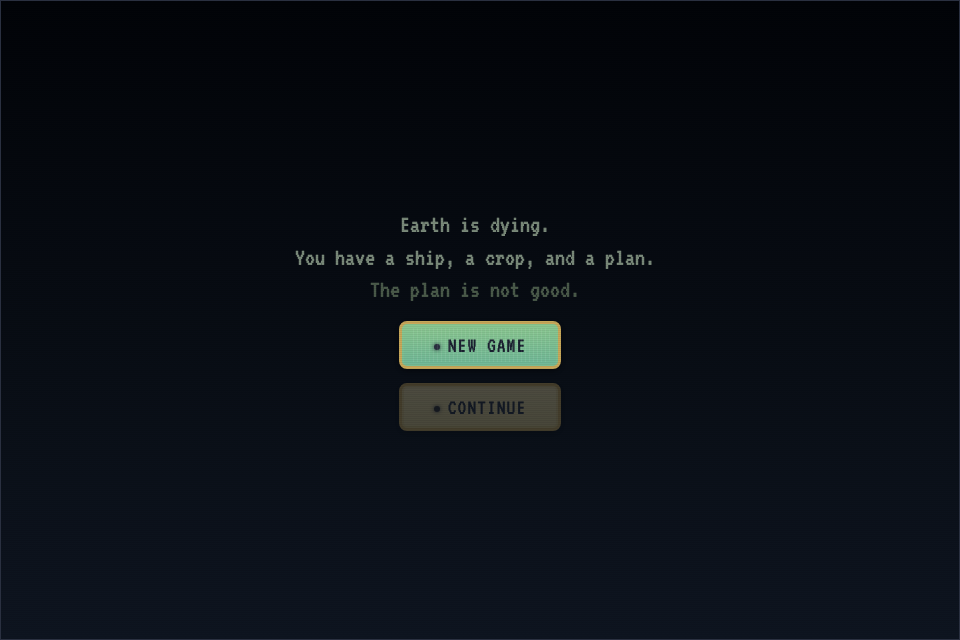
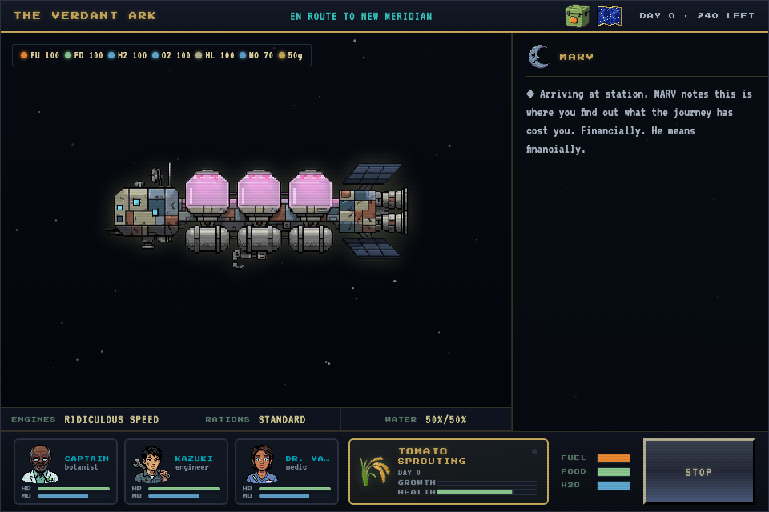
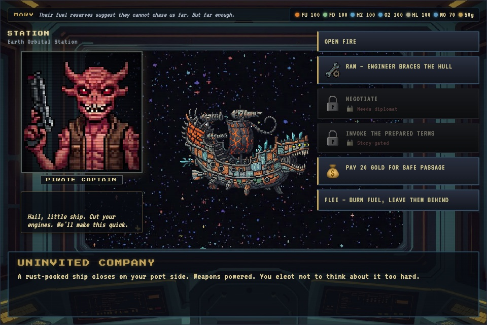
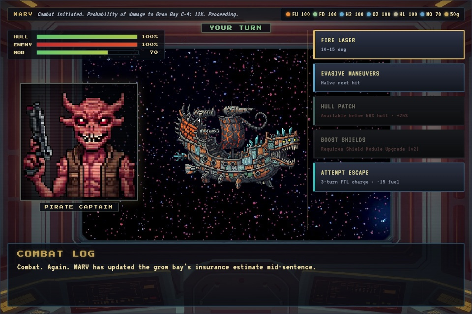
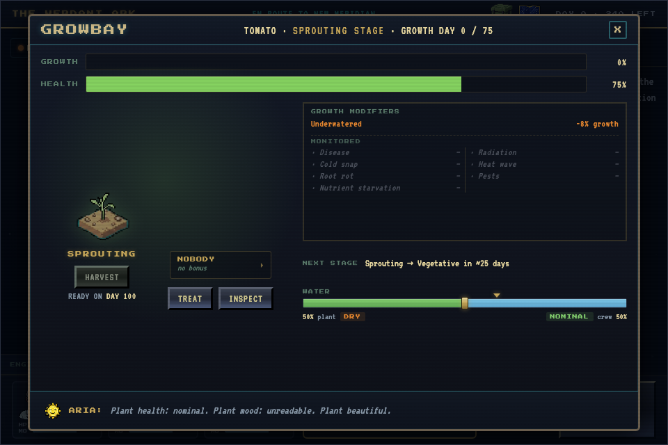

# TRANS-PLANT

> **Earth is dying.
> You have a ship, a crop, and a plan.
> The plan is not good.**

### ▶ [Play it now in your browser](https://interstellarharvest.github.io/Trans-plant/)

No install, no account, no download. One click and you're in orbit.

### 📖 [Read the manual](https://interstellarharvest.github.io/Trans-plant/docs/manual/) · [PDF version](https://interstellarharvest.github.io/Trans-plant/docs/manual/Trans-plant-Manual.pdf)

How to play, every screen explained, and — behind a spoiler fence — how the whole engine fits together.



---

## Oregon Trail, but in space. And you're farming.

Governments, corporations, and ordinary people with questionable judgment
are launching colony ships toward any planet that might take them. You are
one of those people. Whether you're qualified is, frankly, beside the point.

Your job is simple. Get one living crop across the galaxy and plant it in
new soil. It's the seed of a whole new world, and it's currently sitting in
a grow bay next to the coolant line.

**Trans-plant** is a roguelike narrative adventure. Every run is a new map,
a new crew, new disasters and a new ending. It's Douglas Adams by way of
*The Far Side* and *Oregon Trail*: deadpan, a little bleak, and much
funnier than a trip this doomed has any right to be.



---

## Choose how far you're willing to go

| Trail | Length | The brochure says |
|---|---|---|
| 🌙 **Lunar** | ~3 months | *"Established corridors. You'll be fine. Probably."* |
| 🔴 **Mars** | ~6 months | *"Some charted territory. Some not."* |
| ✦ **Interstellar** | ~10 months | *"Charts stop being useful around month six."* The destination is called Far Garden. It was named by an optimist. |

Each trail is a freshly generated map of stations, planets, derelicts,
asteroid fields, nebulae, anomalies and the void. Forks in the route are
real decisions, and there's no going back.

## Assemble the worst possible dream team

**Pick your ship's AI.** You'll be listening to it for the whole trip. Choose wisely.

- **ARIA**: relentlessly positive, factually questionable. ARIA believes in you. ARIA believes in everything.
- **MARV**: clinically depressed and 400% smarter than everyone. He has already calculated your odds.
- **REX**: retired military. Everything is a threat, including the snack dispenser.
- **CHIP**: corporate-issued and full of Terms of Service. Every crisis is a sponsored message.
- **AJOY**: a passive-aggressive backseat driver. AJOY will help you make better decisions, and AJOY will make sure you know about it.

**Pick your captain.** That's you, with one of ten backgrounds: botanist,
engineer, veteran, merchant, or an academic whose grant funding was cut.
(You are in space. These events are related.)

**Hire up to two crew** from a roster of specialists. Dr. Osei has opinions
about every plant. Kazuki fixes anything and eats twice as much. Dr.
Vasquez is chronically anxious and excellent at the job. Lindqvist the pilot
is correct 78% of the time. Each of them has a skill that will save the
mission exactly once, if you remember to use it.

**Pick the crop** that carries the future of humanity: wheat, tomato,
sweet potato, soybean, or a zinnia. The zinnia feeds no one. It just makes
everybody feel better, which out here counts for a lot.

**Then name your ship.** The default is *The Verdant Ark*. You can do better. You can also do much worse.

---

## Out there, things happen



Along the way you'll meet pirates, traders, drifters, bartenders, a
janitor with information, and a navigation buoy with opinions. **Nearly a
hundred hand-written events** draw from a weighted, rule-driven pool, so
no two runs play out alike. Every alien species speaks with its own
grammar. Choices depend on who's aboard, what's in the cargo hold, and
what you did three stops ago. Spare a pirate and they may remember you.
Answer a mayday and someone may answer yours.

When talking fails, **turn-based ship combat** takes over: fire, evade,
patch the hull, or charge the FTL and pray.



## Keep the plant alive. Keep everyone else alive. In that order.



- **The Growbay.** Water, treat, inspect and assign a tender. Pests,
  disease, drought and a split water supply mean the crop and the crew are
  always competing for the same tank.
- **Standing orders.** Set the engines (Light, Ridiculous, Ludicrous, or
  Plaid), the rations (Vending Machine, Standard, or Pig Out) and the
  water split, then watch the projections tell you exactly when it all
  runs out.
- **Hands-on minigames.** Mine asteroids, scan anomalies, forage alien
  worlds, triage wounded crew, brace for solar storms, weld a hull breach
  shut, salvage derelicts, and crawl through the engine room flipping
  breakers in the dark.
- **The Fabricator.** Turn scrap into hull patches, fuel cells and oxygen,
  until it breaks.
- **The Ship's Log.** A journal of everything that happened, with real
  science behind the jokes, and a memorial page for the ones who didn't
  make it.

## How does it end?

There are **twelve endings**, from *The Textbook Case* to *Arrival, Comma,
Technically*. There are also six ways to never arrive at all: *Dead Stop*,
*Structural Failure*, *Management Restructuring*, and others.

And if you reach the new world with a dead plant in the grow bay? You
made it. *It* didn't. The game will let you sit with that.

---

## How to play

**Online (easiest):**
**[interstellarharvest.github.io/Trans-plant](https://interstellarharvest.github.io/Trans-plant/)**

**On your own computer:** download this repository (**Code → Download ZIP**,
or `git clone`), unzip it, and **double-click `index.html`**. There's
nothing to install and no server to run.

- Built for a desktop browser with a mouse and keyboard. **ESC** opens the
  pause menu.
- Your run autosaves in the browser. Hit **Continue** on the title screen
  to pick up where you left off.
- The game is deliberately silent. Bring your own soundtrack.
- **Windows note:** the repository uses a symbolic link (`sprites`), which
  Windows doesn't create by default when unzipping or cloning. On Windows,
  play the online version, or clone with symlinks enabled
  (`git clone -c core.symlinks=true …` with Developer Mode on).

---

## For developers

Plain HTML, CSS and JavaScript: no framework and no build step to play.
Game content (events, crew, items, endings and flavor text) lives as JSON
in `modules/`. The engine is `index.html` plus `engine/js/`.

After editing anything in `modules/`, regenerate the double-click data
bundle, then run the checks:

```sh
node tools/build_portable.js     # refresh engine/js/portable_data.js (file:// launch)
node tools/lint_modules.js       # content lint; also fails if the bundle is stale
python3 -m http.server 8177      # then, with Playwright installed:
node tools/fuzz_playthrough.js   # randomized full-run audits
node tools/ui_sweep.js           # real-click UI sweep
```

Served over http, the engine reads the JSON directly. Opened from disk, it
reads the generated bundle, because browsers block file:// fetches.
